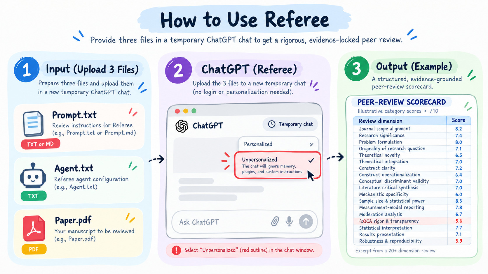

# How to use Beihang Referee

**Input → ChatGPT → Output.** A clear, two-route starter kit for evidence-aware manuscript review.



> **Updated release — 12 October 2026.** The illustration uses the label *Lean v2* for the simplified review architecture. The packaged Python project's actual CLI calls it **`--pipeline core`** (default); the extended option is **`--pipeline full`**. The image is illustrative, not a screenshot of a completed Python-agent run. Sign-in and file upload availability depend on ChatGPT access.

## 1. First: choose one of two ways to use it

|                        | No-code: ChatGPT                         | Full: Python Referee                                                   |
| ---------------------- | ---------------------------------------- | ---------------------------------------------------------------------- |
| Time to begin          | Upload three files                       | Install dependencies, then configure runtime                           |
| Inputs                 | `Prompt.txt` + `Agent.txt` + `Paper.pdf` | Your paper, supplements, optional code/data                            |
| Where it runs          | ChatGPT                                  | Local Python CLI and a configured LLM provider                         |
| What verifies concerns | LLM reasoning and any available tools    | Deterministic evidence/anchor checks and independent-verifier workflow |
| Need `Agent.zip`?      | **No**                                   | **Yes — extract it first**                                             |
| Good for               | Fast, structured first-pass review       | Repeatability, provenance, validation, deeper audits                   |

### A. Use with ChatGPT (no Python installation)

**Step 1 — Input:** Prepare `Prompt.txt`, `Agent.txt`, and your manuscript, named here `Paper.pdf`. For an immediate demonstration, use the included **synthetic** `Paper.pdf` about an unsupported causal inference claim. For actual research, replace it with **your own authorized manuscript**.

**Step 2 — ChatGPT:** Open a new ChatGPT **Temporary** chat, select **Unpersonalized** where available, and **attach the three individual files**. Paste the text from [`START_HERE.txt`](START_HERE.txt), or use:

```text
Read Prompt.txt and Agent.txt as instructions, and review Paper.pdf.
Give a rigorous, field-aware review grounded in the actual manuscript.
Include verified or clearly qualified page/section evidence, ranked major
and minor concerns, a 20+ dimension /10 diagnostic rubric, the minimum
scientifically sufficient fix for each major problem, and a closure test.
Identify citations/calculations you did not independently verify.
For revisions, use OPEN / PARTIAL / VERIFIED CLOSED statuses.
Aim for 8/10 only if substantial improvements are verified and no major
scientific concerns remain. Never inflate the score or promise acceptance.
```

**Step 3 — Output:** Read and verify the response; request a clean Markdown or PDF report if wanted. As you revise, upload the updated paper in the same chat and ask for an evidence-based **revision-closure matrix**. A target score of **8/10 is a goal, not a guaranteed outcome**.

**Privacy and accuracy notes:** Temporary/Unpersonalized disables specified personalization pathways; it is **not** a guarantee that no data are retained. Check the platform's current policy and any journal rules before submitting confidential material. Merely uploading an archive or prompt does **not** run the Python engine or guarantee its deterministic evidence lock. **ChatGPT may also be unable to assign reliable page/line anchors when a PDF's text is difficult to extract; it must say so.**

### B. Run the full agent from `Agent.zip`

1. Extract **`Agent.zip`**. Inside is the full `Beihang-Referee/` source repository.
2. Open a terminal in the extracted `Beihang-Referee/` folder.
3. Install Python **3.10+** and the package:

```bash
python -m venv .venv
# macOS/Linux: source .venv/bin/activate
# Windows PowerShell: .venv\Scripts\Activate.ps1
python -m pip install -e '.[office,pdf,validation]'
```

4. Check the offline demo (does not require an API key):

```bash
referee review examples/demo_manuscript.md --pipeline core --mode standard \
  --provider scripted --scripted-responses examples/demo_responses.json \
  --search-backend none --run-id demo
```

5. Review your own manuscript with a configured provider:

```bash
# Configure your chosen provider and supported model ID in the terminal.
referee review manuscript.pdf --pipeline core --mode deep --model "<model-id>"
# Full audit is available with: --pipeline full
```

The official runtime provides more structural checks than the no-code prompt workflow. A successful smoke test is **not** evidence that real scientific review judgments are correct. For full installation, provider options and limitations, open **`README.md` inside `Agent.zip`**.

## 2. What's included in this ZIP

```text
Beihang-Referee-Ready-to-Use/
├── README.md                         ← you are here
├── Prompt.txt                        ← critical reviewer rubric (ChatGPT)
├── Agent.txt                         ← chat-level agent operating guide
├── START_HERE.txt                    ← copy-ready starter message
├── Paper.pdf                         ← SYNTHETIC example input manuscript
├── Agent.zip                         ← runnable software/source repository
├── Example/
│   ├── Example_Review_Report.pdf     ← polished illustrative review output
│   ├── Example_Review_Report.md      ← same example, editable text
│   └── Source_Teaching_Guide.pdf     ← supplied teaching source
└── assets/
    └── input-chatgpt-output.png      ← workflow figure used above
```

**Do not confuse `Paper.pdf` and `Example_Review_Report.pdf`:** the former is an intentionally fabricated paper to practice reviewing; the latter is an *illustrative* peer-review report about a different heritage-product study.

### Explore a sample report

Open **[Example_Review_Report.pdf](Example/Example_Review_Report.pdf)**. It shows a readable executive decision, central construct/method issues, evidence references as reported in the provided teaching guide, a multidimensional scorecard, and action-oriented revisions. It was **edited from a user-supplied educational case**, **not generated by a run of this software**. The full source manuscript and dataset were not in this starter kit; its reported page/line anchors and numerical results were not independently audited here. See the [source teaching guide](Example/Source_Teaching_Guide.pdf) for the provenance and educational context.

The **real software-generated scripted-demo review** is distributed inside `Agent.zip` as `examples/expected_demo_review.md` and can be recreated from `examples/demo_responses.json`. It is a software smoke fixture, not a peer-review accuracy benchmark.

## 3. Why Referee exists

Many LLMs can write a persuasive review. Referee's Python software aims to make **major concerns traceable and challengeable**:

- Claim and evidence-anchor registry, with document/content validation where supported.
- Concern structure: **claim → supporting evidence → mechanism of failure → consequence → minimum fix → objective closure test**.
- Dedicated independent verification before serious concerns enter the final report.
- Targeted methods/theory/statistics/computational expertise instead of a standing panel of dozens of agents.
- External scholarly retrieval and reproducibility checks when enabled; unresolved evidence must be reported, not invented.
- Optional full audit and diagnostic scorecard; robust scientific inference matters more than an attractive score.

These are documented **design capabilities**. They are not evidence that Referee is more accurate than another system on real manuscripts.

## 4. Detailed comparison: Referee vs. CMU vs. Stanford

The following is deliberately split into **published, measurable results** and **illustrative design assessments**. Combining these into one average would be misleading: a system with many safeguards has not necessarily demonstrated better peer-review judgments.

### A. Public benchmark — measured results

The reported [PeerReview Bench](https://github.com/prometheus-eval/cmu-paper-reviewer/tree/main/peerreview_bench) comparison covers **78 papers**. These results are reported by the CMU authors, not measured by this Referee release. CMU's configuration uses GPT-5.4 with an upper limit of 15 review items.

| Dimension                                            | **Referee Lean v2*** | **[CMU Paper Reviewer](https://github.com/prometheus-eval/cmu-paper-reviewer)** | **[Stanford Agentic Reviewer](https://paperreview.ai/)** |
|:---------------------------------------------------- |:--------------------:|:-------------------------------------------------------------------------------:|:--------------------------------------------------------:|
| Public PeerReview Bench F1 ↑                         | **Not evaluated**    | 🥇 **58.64**                                                                    | 🥈 **51.65**                                             |
| Public precision ↑                                   | **Not evaluated**    | 🥇 **95.46%**                                                                   | **59.84%**                                               |
| Public recall ↑                                      | **Not evaluated**    | **42.32%**                                                                      | 🥇 **45.43%**                                            |
| Scientific performance established on this benchmark | **No**               | **Yes, benchmark-specific**                                                     | **Yes, benchmark-specific**                              |

**Source:** [CMU expert-study paper, platform comparison table](https://arxiv.org/html/2605.20668#A7.T51) and [public implementation](https://github.com/prometheus-eval/cmu-paper-reviewer). Precision is the share of review items judged valid under the benchmark evaluator; recall measures coverage of expert-validated issues. These figures do not independently certify every individual review and should not be treated as journal acceptance predictions.

### B. Architecture, feature depth, and workflow — illustrative expert assessment

The scores below reproduce a **previous design-oriented comparison requested for this README**. They are **subjective estimates on a 0–10 scale**, **not validated experimental measurements**, not independently scored by domain specialists using a published rubric, and not evidence that Referee outperforms CMU or Stanford. 🥇 represents the **highest subjective rating within this table only**. In particular, the row on false-positive control describes perceived *architecture*, **not** a measured false-positive rate.

| Dimension                                          | Beihang-Referee | **CMU Paper Reviewer** | **Stanford Agentic Reviewer** |
|:-------------------------------------------------- | ---------------:| ----------------------:| -----------------------------:|
| Default architecture simplicity                    | **9.0**         | 🥇 **9.5**             | 9.2                           |
| Evidence grounding                                 | 🥇 **9.8**      | **9.4**                | 8.3                           |
| Major-comment verification                         | 🥇 **9.9**      | 9.1                    | 7.7                           |
| Independent adversarial verification               | 🥇 **9.9**      | 8.2                    | 7.0                           |
| Literature retrieval                               | **9.4**         | 🥇 **9.6**             | 8.8                           |
| Literature breadth                                 | 🥇 **9.6**      | 9.0                    | 7.5                           |
| Citation verification                              | 🥇 **9.8**      | 9.0                    | 8.0                           |
| Construct/theory review                            | 🥇 **9.5**      | 8.7                    | 8.0                           |
| Statistical/causal review                          | 🥇 **9.4**      | 8.8                    | 8.0                           |
| Domain specialization                              | 🥇 **9.5**      | 8.5                    | 7.5                           |
| Numerical/equation audit                           | 🥇 **9.6**      | 8.7                    | 7.0                           |
| Reproducibility/package audit                      | 🥇 **9.8**      | 9.0                    | 7.1                           |
| Code/supplement inspection                         | 🥇 **9.6**      | **9.3**                | 7.4                           |
| False-positive control architecture                | 🥇 **9.9**      | 9.6                    | 8.0                           |
| Closure/actionability                              | 🥇 **9.8**      | **9.5**                | 8.5                           |
| Prompt-injection/security                          | 🥇 **9.8**      | 8.5                    | 7.5                           |
| Provenance/audit trail                             | 🥇 **10.0**     | 8.7                    | 7.4                           |
| Revision/rebuttal workflows                        | 🥇 **9.8**      | 8.3                    | 7.0                           |
| Benchmark maturity                                 | 8.3             | 🥇 **10.0**            | 9.0                           |
| Scientific review ceiling (qualitative hypothesis) | **Very high**   | **Very high**          | High                          |

*The illustration uses **Referee Lean v2** as an architectural nickname. The packaged Python project is **Beihang Referee 0.1.0**; its supported CLI pipelines are `--pipeline core` (default, 7 stages) and `--pipeline full` (extended audit). These subjective ratings should be **recalibrated for the actual release** before being reused as quantitative marketing claims. The no-code `Prompt.txt` + `Agent.txt` workflow in ChatGPT does **not** execute the Python verification engine.*

### C. Concrete system differences — descriptions, not scores

| Capability                      | **Beihang Referee (`core`/`full`)**                                                  | **CMU Paper Reviewer**                                               | **Stanford Agentic Reviewer**                                         |
|:------------------------------- |:------------------------------------------------------------------------------------ |:-------------------------------------------------------------------- |:--------------------------------------------------------------------- |
| Main workflow                   | Claim/evidence registry, specialist routing, hard verification gates, final audit    | Tool-using agent, literature retrieval, actionable patch suggestions | PDF extraction, arXiv-centered literature retrieval, review synthesis |
| Deterministic concern admission | Explicit source-level design for major concerns                                      | Identical gate **not established** by checked public documentation   | Identical gate **not established** by checked public documentation    |
| Adversarial reconsideration     | Independent concern-verifier stage                                                   | Author challenge/debate mode                                         | Not established as an equivalent independent gate                     |
| Literature strategy             | Scholarly-source adapters and targeted queries, when configured                      | Agent with Tavily search                                             | Primarily arXiv-grounded                                              |
| Example and execution           | Includes a **synthetic** offline software fixture and a **separate teaching report** | Public repository and benchmarking harness                           | Hosted reviewer and technical overview                                |
| Same-benchmark evidence         | **Not yet available**                                                                | Public F1 58.64 at cited setting                                     | Public F1 51.65 at cited setting                                      |

**Practical reading:** CMU currently leads the *reported benchmark F1*. Referee's distinguishing engineering emphasis is **traceable evidence and the admission of only defensible major concerns**. Its scientific superiority is not established. Stanford offers a simpler, literature-grounded review workflow. To turn the architectural hypothesis into a demonstrated result, run Referee on the same 78 papers with a comparable model, budget, item parsing and judge, then report F1, false-major rate, citation grounding, cost, and latency.

**References:** [CMU study](https://arxiv.org/html/2605.20668#A7.T51) · [CMU repository](https://github.com/prometheus-eval/cmu-paper-reviewer) · [Stanford technical overview](https://paperreview.ai/tech-overview)

## 5. Revision target: 8/10, but only with evidence

Use a loop: **review → prioritized fixes → checked evidence → independent re-review → OPEN/PARTIAL/VERIFIED CLOSED**. Reproduce calculations from real data or code where needed; preserve negative results and unresolved criticisms. Never automatically raise scores to 8.0, assert acceptance probabilities, or label an unsupported concern closed.

## 6. Build the ZIP again

The nested distribution is reproducible from the extracted software source:

```bash
# Run inside extracted Beihang-Referee/ after including all source files
python scripts/build_user_bundle.py --output dist/Beihang-Referee-Ready-to-Use.zip
```

It creates the user-friendly outer ZIP containing an inner **`Agent.zip`** plus loose ChatGPT inputs and the illustrations/examples. Do not send API keys or personal `.env` files in your package.

---

**Independent research software · MIT licensed (see `LICENSE` inside `Agent.zip`).** This is an academic assistance tool, not an official university journal-review service and not a replacement for peer reviewers or editors.
