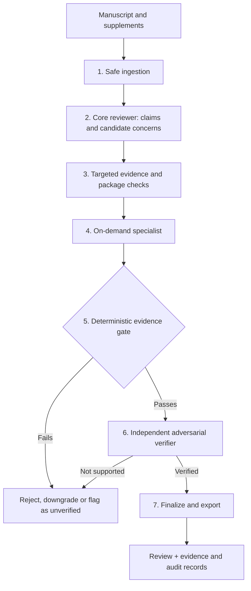

# How to use it — Input → ChatGPT → Output


**Start in ChatGPT without installing Python.** Use the included [Prompt.txt](chatgpt/Prompt.txt) and [Agent.txt](chatgpt/Agent.txt) with your own `Paper.pdf`. The figure shows an **illustrative user workflow**, not a demonstration that the full Python agent has been executed inside ChatGPT.

| Stage           | What to do                                                                                                                         | What you get                                                  |
| --------------- | ---------------------------------------------------------------------------------------------------------------------------------- | ------------------------------------------------------------- |
| **1 · INPUT**   | Prepare **`Prompt.txt` + `Agent.txt` + `Paper.pdf`**.                                                                              | Review rubric, agent instructions, and the actual manuscript. |
| **2 · CHATGPT** | Start a **New Chat → Temporary → Unpersonalized**; upload the three files; send the message below.                                 | Manuscript-centered review using the provided instructions.   |
| **3 · OUTPUT**  | Read the structured critique, verified/uncertain anchors, major and minor concerns, construct audit, scorecard, and revision plan. | A report to inspect, challenge, and act on.                   |

**Copy this message after attaching the three files:**

```text
Read Prompt.txt and Agent.txt carefully, and review the attached Paper.pdf.
Follow the scientific review criteria, citing actual manuscript evidence.
Provide a structured peer-review report with a 20+ dimension scorecard,
ranked major criticisms, minimum resolutions, and measurable closure tests.
Distinguish verified issues from uncertain/unverified issues.
Do not claim any source or analysis was independently verified unless it was.
When I upload a revision, repeat the critical assessment and show an issue-
closure matrix. Aim for 8/10 or higher only if evidence supports the score
and all material major concerns are resolved; do not inflate the rating.
```

**How to continue:** attach a revised paper (and any needed data, code, or supplementary evidence) in the same conversation and request: *“Re-evaluate every original major concern, mark OPEN / PARTIAL / VERIFIED CLOSED with evidence, then rescore independently.”*

**Two different ways to use Referee:** This **ChatGPT file-upload workflow** uses portable prompt instructions; uploading `Agent.txt` or a software ZIP **does not run the Python engine** or guarantee its independent verification. For the **actual evidence-locked software runtime**, use the [installation and CLI instructions](#quick-start--offline-first) below. Temporary Chat can be Unpersonalized, but sign-in and file-upload access depend on the account; temporary chats are not a guarantee that no copies are retained. See the [official Temporary Chat documentation](https://help.openai.com/en/articles/8914046).

[ChatGPT-ready files and detailed instructions](chatgpt/README.md) · [Example review output](examples/heritage_product_review/illustrative_review_report.md) · [Offline reproducible software demo](examples/expected_demo_review.md)

---

## Beihang Referee — evidence-locked scientific peer review

<p align="center"><strong>Evidence-locked scientific peer review, designed for auditable criticism.</strong></p>

<p align="center">
  <a href="LICENSE"></a>
  <a href="pyproject.toml"></a>
  <a href="docs/evaluation/VALIDATION.md"></a>
  <a href="examples/heritage_product_review/README.md"></a>
</p>

<p align="center">
  <a href="#quick-start--offline-first">Quick start</a> ·
  <a href="#what-a-review-looks-like">Example report</a> ·
  <a href="#how-it-works">Architecture</a> ·
  <a href="#comparison-with-public-ai-reviewers">Comparison</a> ·
  <a href="#using-referee-on-your-paper">Usage</a> ·
  <a href="#validation-and-honest-limitations">Validation</a>
</p>

> **Updated edition · 12 October 2026.** This README documents the **uploaded Beihang Referee build** (`beihang-referee` package version `0.1.0`), whose default initial-review pipeline is **`core`**, not the older `lean` CLI spelling. The broader pipeline is **`full`**. This documentation update also introduces a polished illustrative review example. It is **not** a claim of new benchmark performance or a new model release.

**Beihang Referee** is an open-source, AI-assisted manuscript-review engine. Rather than accepting a plausible model-generated criticism at face value, it records manuscript claims and evidence, performs targeted checks, applies deterministic gates, and independently challenges proposed major criticisms before finalizing a report.

**Its guiding question is not “How many weaknesses can an LLM produce?” but “Which criticisms can be defended with inspectable evidence?”**

Beihang Referee is independent research software; it is **not** an official Beihang University review service. It supports, but does not replace, independent scientific and editorial judgment.

## At a glance

| You need to…                                                                         | Start here                                                                                                                                                                              |
| ------------------------------------------------------------------------------------ | --------------------------------------------------------------------------------------------------------------------------------------------------------------------------------------- |
| See the system work **without an API key**                                           | [Offline demo](#quick-start--offline-first) · [Reference generated output](examples/expected_demo_review.md)                                                                            |
| See a **publication-style example** with priorities, scoring, and revision decisions | [Illustrative case report (PDF)](examples/heritage_product_review/illustrative_review_report.pdf) · [Readable Markdown](examples/heritage_product_review/illustrative_review_report.md) |
| Review your own PDF/DOCX with a model                                                | [Real manuscript walkthrough](#using-referee-on-your-paper)                                                                                                                             |
| Compare lean/core vs extended/full workflows                                         | [Pipelines and modes](#how-it-works)                                                                                                                                                    |
| Check evidence/verification safeguards                                               | [Evidence lock](docs/architecture/EVIDENCE_LOCK.md)                                                                                                                                     |
| Verify package integrity and examine evaluation                                      | [Validation guide](docs/evaluation/VALIDATION.md)                                                                                                                                       |

## Quick start — offline first

**Requirements:** Python **3.10+** and a local checkout of this repository. Run commands **from the repository root**. Shell examples use macOS/Linux syntax; Windows PowerShell commands follow below.

```bash
python -m venv .venv
source .venv/bin/activate
python -m pip install -e '.[office,pdf,validation]'
referee --version
```

**Windows PowerShell:**

```powershell
py -m venv .venv
.venv\Scripts\Activate.ps1
python -m pip install -e ".[office,pdf,validation]"
referee --version
```

Run the **deterministic demo**. It uses a checked-in scripted model fixture; **no account, API key, or internet access is required**.

```bash
referee review examples/demo_manuscript.md \
  --pipeline core --mode standard \
  --provider scripted \
  --scripted-responses examples/demo_responses.json \
  --search-backend none --run-id demo
```

Read the result at `runs/demo/artifacts/review.md`, or compare it with the [expected demo review](examples/expected_demo_review.md). This is a **software smoke example**, not an evaluation of the system's scientific accuracy.

## What a review looks like

The worked heritage-product example demonstrates the *human-readable presentation we recommend*:

> **Overall assessment · Major revision (illustrative)**  
> **Holistic assessment:** 7.0/10 · **Evidence base:** reported cross-sectional survey, N = 496  
> **Priority issue:** a construct labeled *Perceived Cultural Continuity* contains items that cover cultural memory, meaning, values, and temporal continuity; this calls for a content-validity decision before interpreting the structural paths.  
> **Minimum resolution:** compare the exact administered items to the stated construct definition and either justify the original label or transparently revise the conceptual framing.  
> **Closure test:** manuscript terminology, theory, hypotheses, figures, tables, and implications must agree with a documented item-level interpretation.

**Explore the example:**

| File                                                                                                    | Purpose                                                                                     |
| ------------------------------------------------------------------------------------------------------- | ------------------------------------------------------------------------------------------- |
| [Illustrative review report · PDF](examples/heritage_product_review/illustrative_review_report.pdf)     | Visually polished, concise example for readers and presentations                            |
| [Illustrative review report · Markdown](examples/heritage_product_review/illustrative_review_report.md) | GitHub-native report with evidence notes, priorities, and a 28-dimension teaching scorecard |
| [Original teaching guide · PDF](examples/heritage_product_review/source_teaching_guide.pdf)             | The user-supplied 15-page pedagogical source used for this example                          |
| [Example user review prompt](examples/heritage_product_review/user_review_prompt.txt)                   | User-supplied senior-reviewer instruction, **not** a runtime system prompt                  |
| [Example provenance / limitations](examples/heritage_product_review/README.md)                          | What was actually verified, what was not, and how to reproduce a real software run          |

**Evidence label:** the polished case report is an **editorially formatted teaching illustration based on the supplied guide**. The complete manuscript, raw observations, and original code were not provided for this build; **this example was not generated or independently verified by running Referee**. Anchors in the case refer to an underlying manuscript described by the guide, not to files distributed in this repository. The verified **software-generated** offline example remains [`examples/expected_demo_review.md`](examples/expected_demo_review.md). Do not use the teaching case as proof of model performance.

## How it works



The default **Core Review Pipeline** uses **seven stages** and three model-facing reasoning roles: **Core Reviewer**, **Specialist Executor**, and **Independent Verifier**. Specialists run only where a manuscript's proof burden warrants them. Deterministic code owns intake checks, IDs, evidence/closure validation, provenance, and admission of verified concerns.

The wider **Full Audit Pipeline** (`--pipeline full`) retains additional scrutiny where time and cost justify it. Pipeline selection and review depth are separate controls:

| Option              | Meaning                                                        | Example                                                 |
| ------------------- | -------------------------------------------------------------- | ------------------------------------------------------- |
| `--pipeline core`   | Default seven-stage review                                     | Fast, focused manuscript assessment                     |
| `--pipeline full`   | Broader multi-stage audit                                      | In-depth assessment / methodological audit              |
| `--mode standard`   | Bounded depth                                                  | Initial feedback                                        |
| `--mode deep`       | Recommended review depth                                       | Substantive pre-submission analysis                     |
| `--mode exhaustive` | Highest available review depth                                 | Targeted deep audit; higher cost                        |
| `--scorecard`       | Optional **50-dimension** diagnostic *after* scientific review | Detailed quality profile, not a publication probability |

A major criticism is expected to contain **affected claim → evidence anchor → failure mechanism → scientific consequence → minimum sufficient resolution → closure criterion → independent verification**. Missing or unsupported evidence can cause a criticism to be rejected or downgraded. For implementation details, see [Review Pipeline](docs/REVIEW_PIPELINE.md), [Architecture](docs/architecture/OVERVIEW.md), and [Evidence Lock](docs/architecture/EVIDENCE_LOCK.md).

## Using Referee on your paper

Install common extras for PDF/DOCX and scholarly retrieval:

```bash
python -m pip install -e '.[office,pdf,scholarly,validation]'
```

Set an OpenAI-compatible endpoint (use your provider's **supported model identifier**):

```bash
export OPENAI_API_KEY="<your-api-key>"
export REFEREE_MODEL="<supported-model-id>"
# Optional independent verifier model
export REFEREE_VERIFIER_MODEL="<supported-verifier-id>"
```

PowerShell equivalents:

```powershell
$env:OPENAI_API_KEY="<your-api-key>"
$env:REFEREE_MODEL="<supported-model-id>"
```

**Run a review:**

```bash
referee review manuscript.pdf --pipeline core --mode deep --model "$REFEREE_MODEL"
```

The following should also work in this updated edition, because **`core` is the CLI default**:

```bash
referee review manuscript.pdf --mode deep --model "$REFEREE_MODEL"
```

**Review supplementary evidence:**

```bash
referee inspect-package manuscript.docx supplement.docx data.xlsx analysis.ipynb
referee review manuscript.docx supplement.docx data.xlsx analysis.ipynb \
  --pipeline core --mode deep --model "$REFEREE_MODEL"
```

**Disable external retrieval** (novelty/prior-art judgments cannot be treated as externally verified without verified sources):

```bash
referee review manuscript.pdf --pipeline core --search-backend none --model "$REFEREE_MODEL"
```

**Generate an additional scorecard** after the review state is frozen:

```bash
referee review manuscript.pdf --pipeline core --mode deep --scorecard --model "$REFEREE_MODEL"
```

**Expanded audit:**

```bash
referee review manuscript.pdf --pipeline full --mode deep --model "$REFEREE_MODEL"
```

The runtime exports a `review.md` path and may write `review.json`, `review.html`, `major_concerns.csv`, provenance and verification records, checkpoints, and a run manifest beneath `runs/<run-id>/artifacts/`. Availability depends on mode and configuration. The manuscript must be **your own, public, or otherwise authorized** for external model processing.

### Revision and reproducibility workflows

```bash
referee compare-revision original.docx revised.docx --json-out revision_diff.json
referee audit-rebuttal response_to_reviewers.docx
referee list-modes
referee list-profiles
referee list-scholarly-providers
referee finalize-run runs/<run-id>
referee verify-handoff runs/<run-id>/artifacts/referee-handoff.zip
```

See [Quickstart](QUICKSTART.md) and [Revision/Rebuttal guide](docs/guides/REVISION_REBUTTAL.md) for context and supported inputs.

## Comparison with public AI reviewers

**Measured performance** and **software features** are not interchangeable. The following published figures are reported for **PeerReview Bench (78 papers)**. Referee has **not** been run on that benchmark in the materials supplied here.

| PeerReview Bench metric       | Beihang Referee (this version) | [CMU Paper Reviewer](https://github.com/prometheus-eval/cmu-paper-reviewer) | [Stanford Agentic Reviewer](https://paperreview.ai/tech-overview) |
| ----------------------------- | ------------------------------:| ---------------------------------------------------------------------------:| -----------------------------------------------------------------:|
| Precision                     | **Not measured**               | **95.46%**                                                                  | 59.84%                                                            |
| Recall                        | **Not measured**               | 42.32%                                                                      | **45.43%**                                                        |
| F1                            | **Not measured**               | **58.64**                                                                   | 51.65                                                             |
| Setup in published comparison | —                              | GPT-5.4, up to 15 items                                                     | Public platform output                                            |

*Source:* [CMU Paper Reviewer](https://github.com/prometheus-eval/cmu-paper-reviewer) and its [expert-annotation study](https://prometheus-eval.github.io/cmu-paper-reviewer/expert-annotation-study.html). These are source-reported results, **not** scores produced by this repository. Comparisons can vary with backbone, token budget, review-item parsing and evaluation protocol.

**Architecture and workflow (documented behavior, not a quality ranking):**

| Area                                                                | Beihang Referee (this build)             | CMU Paper Reviewer                                    | Stanford Agentic Reviewer                             |
| ------------------------------------------------------------------- | ---------------------------------------- | ----------------------------------------------------- | ----------------------------------------------------- |
| Main approach                                                       | Evidence-locked review pipeline          | Tool-using reviewer and patch suggestions             | Literature-grounded agentic reviewer                  |
| Targeted literature access                                          | Federated scholarly adapters             | Literature search                                     | arXiv-centered retrieval                              |
| Dedicated independent verifier and deterministic major-comment gate | **Explicit in runtime design**           | Not established as the same gate in cited public docs | Not established as the same gate in cited public docs |
| Revision/actionability focus                                        | Minimum fix + testable closure criterion | Concrete patch suggestions and challenge mode         | Actionable feedback                                   |
| Deterministic offline review fixture                                | **Included**                             | Not compared here                                     | Not compared here                                     |
| PeerReview Bench result in this README                              | **Not available**                        | **Published**                                         | **Published**                                         |

**Interpretation:** CMU currently leads on the cited measured F1 metric. Beihang Referee's distinct design emphasis is **traceable evidence and review-item admission**, but that design has not demonstrated superior real-paper precision or recall. See [Benchmarking](docs/guides/BENCHMARKING.md) for the next validation step.

## Validation and honest limitations

This repository includes tests, deterministic adversarial/integrity checks, a synthetic validation corpus, versioned schemas, and package checksums. These help establish **software behavior and contract consistency**. They do **not**, by themselves, establish expert-level judgment, correct bibliographic entailment in every domain, reliability of model-generated ratings, or a journal acceptance probability.

```bash
python scripts/rebuild_package_metadata.py
python scripts/validate_package.py
# Optional deterministic integrity campaign
referee validate --suite integrity --output validation-results
```

Further reading: [Validation](docs/evaluation/VALIDATION.md) · [Real-paper evaluation protocol](benchmark_corpus/REAL_WORLD_BENCHMARK.md) · [Security](SECURITY.md).

**Security and confidentiality:** manuscript text is treated as untrusted input; submitted code is inspected rather than executed by default. Do not send confidential manuscripts to external services without explicit authorization and compatibility with venue policy. Follow data-handling rules, keep API keys outside the repository, and review every AI-produced criticism independently.

## Repository guide

| Path                                              | What's inside                                                                         |
| ------------------------------------------------- | ------------------------------------------------------------------------------------- |
| [`examples/`](examples/README.md)                 | Deterministic generated demo **and** transparently labeled illustrative teaching case |
| [`referee/`](referee/)                            | Python engine, providers, document inspection, evidence verification                  |
| [`core/`](core/) and [`skills/`](skills/)         | Prompts, scientific skills, validation contracts                                      |
| [`schemas/`](schemas/)                            | Structured review and verification interfaces                                         |
| [`docs/`](docs/README.md)                         | Architecture, guides and responsible use                                              |
| [`benchmark_corpus/`](benchmark_corpus/README.md) | Synthetic case and real-benchmark protocols                                           |
| [`tests/`](tests/)                                | Package/regression tests                                                              |
| [`dist/`](dist/)                                  | Portable prompt builds **without runtime verification guarantees**                    |

## Contributing, license, and credit

Contributions that improve real-paper evidence accuracy, citation verification, reproducibility, ergonomics, test coverage, and cost/latency measurement are especially welcome. See [Contributing](CONTRIBUTING.md), [Support](SUPPORT.md), and [Security](SECURITY.md).

Distributed under the **MIT License**; see [LICENSE](LICENSE). This work is independent research software. The heritage teaching case is adapted from a user-supplied teaching guide and must not be represented as software-generated or as a completed scientific replication.
