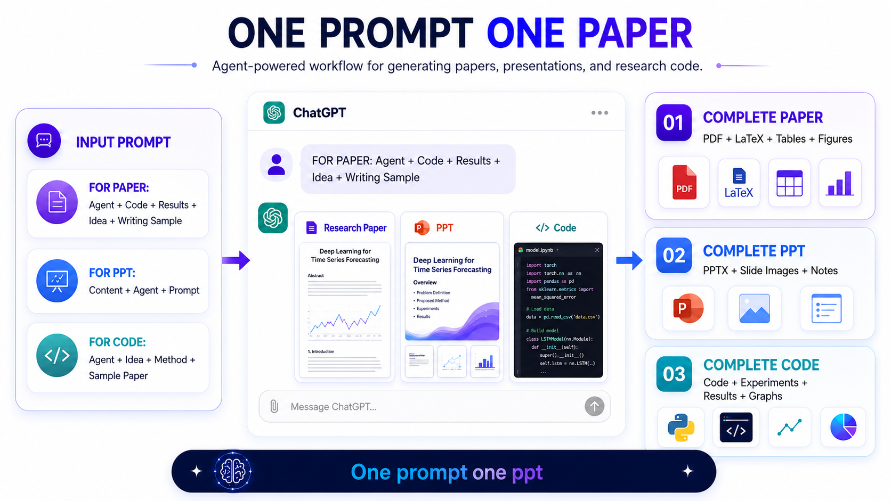

# Claude + ChatGPT Academic Research Skills

Skill files and prompts for taking a research project from idea to reviewed paper with ChatGPT or Claude: idea scoring, literature search, writing, code, review, figures and slides. No API key needed.

**Website:** [raja21068.github.io/claude-chatgpt-academic-research-skills](https://raja21068.github.io/claude-chatgpt-academic-research-skills/) has ready prompts for every step (beginner / researcher / expert), worked examples, and a 5-minute practice review. Source in [`website/`](website/).

**Video:** [How to Create a Full Research Paper with Claude Skills](https://youtu.be/vhvtOVsnYLg)

## What's included

| Step | Folder | What it does |
|---|---|---|
| Idea | [1- idea generation](<1- idea generation>) | Generate ideas, score them out of 100, check novelty (Idea Discovery V5) |
| Literature | [16-Paper-Finder-Search](<16-Paper-Finder-Search (Input 1 Paper + List of Your Favourite Journals )>) | Find papers from one seed paper and your preferred journals |
| Code | [2- code generation](<2- code generation>) | Write and debug experiment code (Research Code Agent V5) |
| Writing | [3- paper-writing](<3- paper-writing>) | Draft the manuscript, tables and results text (Paper Writing Agent V2) |
| Review | [20- Paper Review Agent](<20- Paper Review Agent>) | Evidence-based referee report with page references (Beihang Referee) |
| Review | [4- academic-paper-reviewer](<4- academic-paper-reviewer>) | Multi-reviewer panel, including a devil's-advocate reviewer |
| Figures | [8-Paper-Figure-Generation](8-Paper-Figure-Generation) | Method diagrams, plots and paper illustrations |
| Proofs | [9-Proof-checker](9-Proof-checker) | Check and write mathematical proofs |
| Poster | [5-paper-poster](5-paper-poster) | Turn a paper into a poster |
| Slides | [6-paper-slides](6-paper-slides), [11- slides-polish](<11- slides-polish>), [12-PPT AGENT](<12-PPT AGENT>) | Conference talk slides and a set of PPT style skills |
| Grants | [7-grant-proposal](7-grant-proposal) | Draft a grant proposal |
| Patent | [10- Patent](<10- Patent>) | Invention disclosure through claims, specification and filing format |
| Full pipelines | [13_academic-pipeline-agent.zip](13_academic-pipeline-agent.zip), [14-deep-research-agnet.zip](14-deep-research-agnet.zip), [3_academic-paper_skills_agent_for_all_fileds.zip](3_academic-paper_skills_agent_for_all_fileds.zip) | End-to-end pipeline, deep research, and a general paper-writing skill |
| Other | [15- CV](<15- CV>), [17- Removing AI](<17- Removing AI>), [18-full-stack applications](<18-full-stack applications>), [19-phd_apply_agnet_localy](19-phd_apply_agnet_localy), [Miscs](Miscs) | CV builder, humanizer, SaaS app factory, PhD outreach agent, small general skills |

## Quick start

1. Open the folder for your step and download its `.zip` or `SKILL.md`.
2. **In ChatGPT or Claude (browser):** start a new chat, attach the skill file and your project files, then paste a prompt from the [website](https://raja21068.github.io/claude-chatgpt-academic-research-skills/idea-prompts.html).
3. **In Claude Code:** unzip the skill into `~/.claude/skills/` (or your project's `.claude/skills/`) and call it by name.
4. Open the sources the answer cites and check the numbers before you use them.

Not sure where to begin? Do the [practice review](https://raja21068.github.io/claude-chatgpt-academic-research-skills/#how-to) first.

## Typical order

Idea → literature check → first draft with empty results → code → results → review → revise. Each folder above is one step; the website gives three prompts per step to run in order.

## Credits

- ARIS methodology: [Auto-claude-code-research-in-sleep](https://github.com/wanshuiyin/Auto-claude-code-research-in-sleep)
- PaperOrchestra: [raja21068/PaperOrchestra](https://github.com/raja21068/PaperOrchestra)

