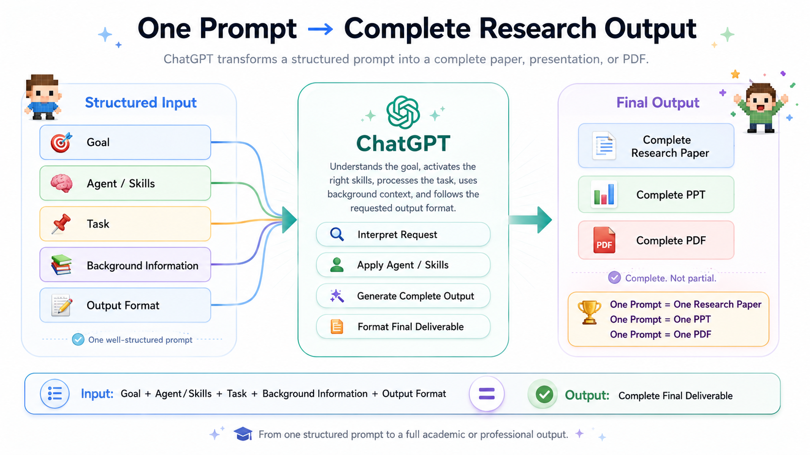

# Claude + ChatGPT Academic Research Skills: One Prompt to Papers, PPTs, PDFs, Code, and Figures

## 🎥 Watch the Demo Video

👉 **Watch on YouTube (starts at 2:00):** [How to Create a Full Research Paper with Claude Skills](https://youtu.be/vhvtOVsnYLg?t=120)

💬 **See a real peer-review chat:** [Peer Review And Rating (ChatGPT share)](https://chatgpt.com/share/6afb2d9c-81c8-83ea-94f2-399016c33ed3)

## 🌐 Student Research Workflow Website

**👉 [raja21068.github.io/claude-chatgpt-academic-research-skills](https://raja21068.github.io/claude-chatgpt-academic-research-skills/)**

A free, step-by-step guide for using these skills with ChatGPT or Claude, from research idea to reviewed paper:

- **[How it works](https://raja21068.github.io/claude-chatgpt-academic-research-skills/#how-it-works)**: the 6 research steps as one picture.
- **[Prompts](https://raja21068.github.io/claude-chatgpt-academic-research-skills/idea-prompts.html)**: ready prompts for every step in **Beginner / Researcher / Expert** versions, with sample answers. Paste your AI answer back to see its score, a quality check, and your score over rounds.
- **[Worked examples](https://raja21068.github.io/claude-chatgpt-academic-research-skills/cases.html)**: two short picture stories (improving an idea, fixing a paper after review).
- **[Practice on a fake paper](https://raja21068.github.io/claude-chatgpt-academic-research-skills/#how-to)**: try a full AI review in about 5 minutes.

Everything runs in your browser. Nothing you type is sent anywhere. Source: [`website/`](website/).

## 🚀 What's included

One prompt in, one finished output out: **a paper** (PDF, LaTeX, tables, figures), **a PPT** (slides and notes) or **code** (runnable, with experiments and graphs).

| Step | Folder | What it does |
|---|---|---|
| Idea | [1- idea generation](<1- idea generation>) | Generate ideas, score them out of 100, check novelty (Idea Discovery V5) |
| Literature | [16-Paper-Finder-Search](<16-Paper-Finder-Search (Input 1 Paper + List of Your Favourite Journals )>) | Find papers from one seed paper and your preferred journals |
| Code | [2- code generation](<2- code generation>) | Write and debug experiment code (Research Code Agent V5) |
| Writing | [3- paper-writing](<3- paper-writing>) | Draft the manuscript, tables and results text (Paper Writing Agent V2) |
| Review | [20- Paper Review Agent](<20- Paper Review Agent>) | Evidence-based referee report with page references (Beihang Referee) |
| Review | [4- academic-paper-reviewer](<4- academic-paper-reviewer>) | Multi-reviewer panel, including a devil's-advocate reviewer |
| Figures | [8-Paper-Figure-Generation](8-Paper-Figure-Generation) | Method diagrams, plots and paper illustrations |
| Proofs | [9-Proof-checker](9-Proof-checker) | Check and write mathematical proofs |
| Poster | [5-paper-poster](5-paper-poster) | Turn a paper into a poster |
| Slides | [6-paper-slides](6-paper-slides), [11- slides-polish](<11- slides-polish>), [12-PPT AGENT](<12-PPT AGENT>) | Conference talk slides and a set of PPT style skills |
| Grants | [7-grant-proposal](7-grant-proposal) | Draft a grant proposal |
| Patent | [10- Patent](<10- Patent>) | Invention disclosure through claims, specification and filing format |
| Full pipelines | [13_academic-pipeline-agent.zip](13_academic-pipeline-agent.zip), [14-deep-research-agnet.zip](14-deep-research-agnet.zip), [3_academic-paper_skills_agent_for_all_fileds.zip](3_academic-paper_skills_agent_for_all_fileds.zip) | End-to-end pipeline, deep research, and a general paper-writing skill |
| Other | [15- CV](<15- CV>), [17- Removing AI](<17- Removing AI>), [18-full-stack applications](<18-full-stack applications>), [19-phd_apply_agnet_localy](19-phd_apply_agnet_localy), [Miscs](Miscs) | CV builder, humanizer, SaaS app factory, PhD outreach agent, small general skills |

### Workflow stages and commands

1. **Idea Generation** — `/idea-discovery`, `/research-lit`
2. **Code Generation** — `/experiment-bridge`, `/run-experiment`
3. **Paper Writing** — `/paper-writing`, `/auto-paper-improvement-loop`
4. **Academic Paper Review** — `/auto-review-loop`, `/proof-checker`
5. **Paper Poster** — `/paper-poster`, `/paper-illustration-image2`
6. **Paper Slides** — `/paper-slides`, `/slides-polish`
7. **Grant Proposal** — `/grant-proposal`
8. **Paper Figure Generation** — `/figure-spec`, `/paper-illustration-image2`
9. **Proof Checker** — `/proof-checker`
10. **Patent (Optional)** — `/patent-draft`

## ⚡ Quick start

1. Open the folder for your step and download its `.zip` or `SKILL.md`.
2. **In ChatGPT or Claude (browser):** start a new chat, attach the skill file and your project files, then paste a prompt from the [website](https://raja21068.github.io/claude-chatgpt-academic-research-skills/idea-prompts.html).
3. **In Claude Code:** unzip the skill into `~/.claude/skills/` (or your project's `.claude/skills/`) and call it by name.
4. Open the sources the answer cites and check the numbers before you use them.

Not sure where to begin? Do the [practice review](https://raja21068.github.io/claude-chatgpt-academic-research-skills/#how-to) first.

## 📚 Acknowledgements

- ARIS Methodology: [Auto-claude-code-research-in-sleep](https://github.com/wanshuiyin/Auto-claude-code-research-in-sleep)
- PaperOrchestra: [PaperOrchestra GitHub](https://github.com/raja21068/PaperOrchestra)
